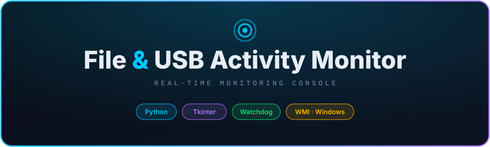
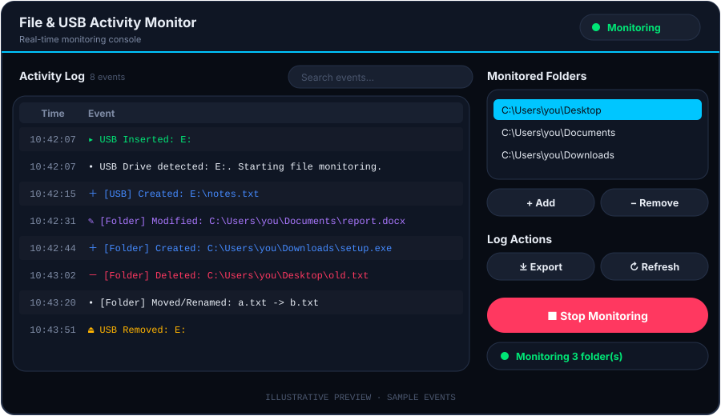
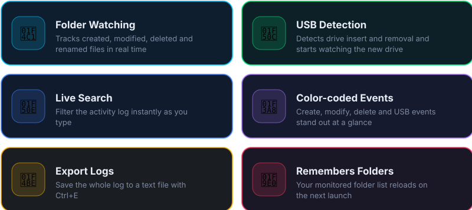
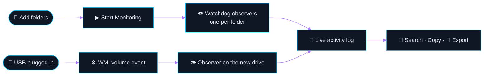

<div align="center">



<br/>


</div>


## 👋 Overview

**File & USB Activity Monitor** is a Windows desktop tool that watches the folders you choose and detects USB drives as they are plugged in or removed. Every event appears in a live, color-coded activity log that you can search, copy and export.

> 💡 *Built to show how file activity and removable media can be tracked in real time, a core idea in security monitoring and digital forensics.*


## 🖥️ Preview

<div align="center">



</div>

<sub>The image above is an illustration of the interface with sample events. To use a real screenshot instead, save it as `preview.png` and change the image path above.</sub>


## ✨ Features

<div align="center">



</div>

### 🎨 Event Types

Each log line is colored by what happened:

<div align="center">


</div>


## 🔄 How It Works



- **Folders** are watched with [`watchdog`](https://pypi.org/project/watchdog/). Each event is logged as `[Folder] Created: <path>`.
- **USB drives** are detected through the Windows `Win32_VolumeChangeEvent` WMI class. Duplicate events are filtered with a one-second debounce, and newly inserted drives are monitored automatically as `[USB]`.
- **The GUI** receives events from background threads and updates the log safely on the main thread.


## 🛠️ Tech Stack

| Layer | Tools |
|-------|-------|
| 🐍 **Language** | Python |
| 🖼️ **Interface** | Tkinter / ttk with custom canvas-drawn dark theme |
| 📁 **File events** | `watchdog` |
| 🔌 **USB events** | `WMI`, `pywin32` (`pythoncom`) |
| 📦 **Packaging** | PyInstaller |


## ⚙️ Getting Started

> **Requires Windows.** USB detection uses WMI, which is not available on Linux or macOS.

```bash
# 1. Clone the repository
git clone https://github.com/martin8281/Log_Monitor.git
cd Log_Monitor

# 2. (Recommended) create a virtual environment
python -m venv venv
venv\Scripts\activate

# 3. Install dependencies
pip install -r requirements.txt

# 4. Run the app
python main.py
```

### 📦 Build a standalone `.exe`

```bash
pip install pyinstaller
pyinstaller main.spec
```

The executable is created in the `dist/` folder.


## 🕹️ Usage

1. Click **+ Add** and choose a folder to watch. Repeat for more folders.
2. Press **▶ Start Monitoring**.
3. Work with files in those folders, or plug in a USB drive, and watch the log update.
4. Use the search box to filter events, then **Export** to save the log.

### ⌨️ Shortcuts

| Key | Action |
|-----|--------|
| `F5` | Refresh the log view |
| `Ctrl` + `E` | Export the log to a text file |
| `Del` | Remove the selected folder |
| Right-click | Copy the selected log rows |


## 📁 Project Structure

```text
Log_Monitor/
├── main.py                  # Entry point and logging setup
├── app_gui.py               # Dark Tkinter interface
├── file_monitor.py          # Watchdog observers and log export
├── usb_monitor.py           # WMI USB insert/removal detection
├── event_log_monitor.py     # Windows Security log reader (standalone, optional)
├── file_access_log.py       # File access audit helper (standalone, optional)
├── main.spec                # PyInstaller build config
├── monitored_folders.txt    # Saved folder list (created by the app)
├── authorized_usb_devices.txt  # Reserved for a future USB allow-list
└── requirements.txt
```

### 🗂️ Files created while running

| File | Purpose |
|------|---------|
| `monitored_folders.txt` | Your watched folders, reloaded on start |
| `app_monitor.log` | Application log, overwritten on each launch |
| `file_usb_activity_log.txt` | Exported activity log (location chosen on export) |


## ⚠️ Disclaimer

> This tool is for **authorized monitoring and educational use only**. Run it only on computers and drives you own or have permission to monitor.

## 👤 Author

<div align="center">

**Martin Thomas** · M.Sc. AI & Cyber Security, CHRIST (Deemed to be University)

[](https://linkedin.com/in/martin-thomas)
[](https://github.com/martin8281)

⭐ *If you find this useful, give it a star.*


</div>
